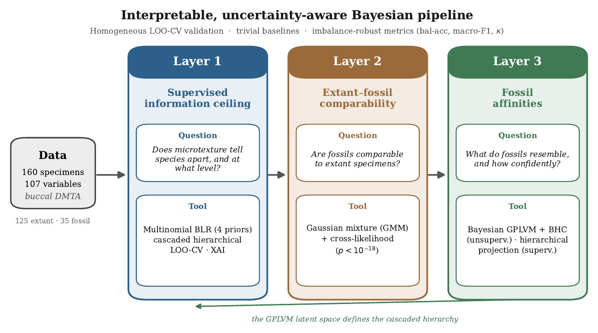
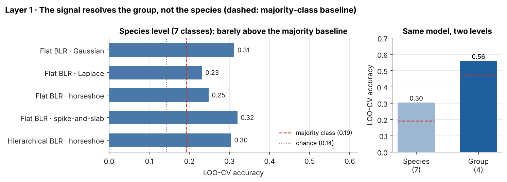
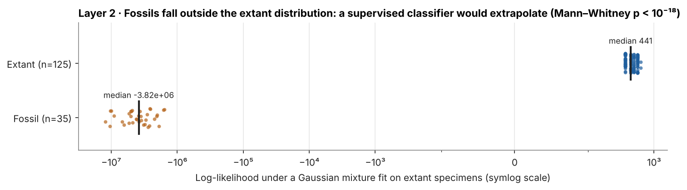
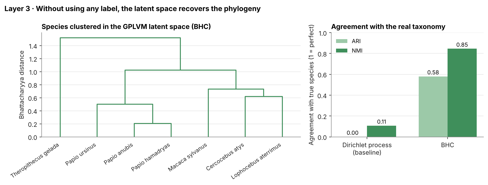

# Bayesian Uncertainty Quantification for Noisy, Small-Sample Classification

### Interpretable, uncertainty-aware classification of primate dental microtexture

**Bachelor's Thesis (B.Eng.) — Mathematical Engineering and Artificial Intelligence**  
ICAI, Universidad Pontificia Comillas · 2025–2026 · [Full thesis (PDF, Spanish)](thesis.pdf)  
Author: **Xabier Albizu Arias** · Advisors: Simón Rodríguez Santana, Jaime Pizarroso Gonzalo

---

## Overview

Can microscopic wear on primate teeth tell species apart, and can it say anything reliable about fossils? The data is the hard part: **160 specimens** (125 extant from 7 species with known diet, 35 fossils from extinct taxa) described by **107 noisy, highly correlated microtexture variables**.

Instead of chasing the best classifier, this project asks **how far the signal can actually be trusted**, and attaches an uncertainty to every claim. The contribution is not a new method but an **analysis architecture**: three Bayesian layers, each answering a question that decides whether the next one makes sense.



## Key results

| Result | Value |
|---|---|
| Species-level accuracy, 7 classes (best flat model: spike-and-slab BLR) | 0.32 (majority class 0.19, chance 0.14) |
| Species-level accuracy, reference hierarchical model | 0.30 |
| Group-level accuracy, 4 groups, same hierarchical model | 0.56 (majority class 0.47) |
| Extant–fossil domain shift (Mann–Whitney on GMM log-likelihoods) | *p* < 10⁻¹⁸ |
| Unsupervised phylogeny recovery (BHC on the GPLVM latent space) | NMI = 0.85, ARI = 0.58 |
| Dirichlet-process baseline | NMI = 0.11 (82% of specimens in one component) |

All accuracies are exact leave-one-out cross-validation on the 125 extant specimens.

---

## The three layers

### Layer 1 — How much does the signal support? (supervised)

Multinomial Bayesian logistic regression on the extant specimens, the only ones with known labels, with **four shrinkage priors** (Gaussian, Laplace, horseshoe, spike-and-slab) and a **hierarchical cascade** whose tree is learned from the latent space of Layer 3. Classical models (Random Forest, SVM, logistic regression) serve as baselines.



**Finding:** the signal resolves the **group** but **not the species**. Every model, Bayesian or classical, stays close to the majority-class baseline at species level, so the ceiling is a property of the **data, not the model**. The Bayesian models do not beat the classical ones on raw accuracy; what they add is a calibrated uncertainty for every prediction. The priors also reveal a calibration–accuracy trade-off: the best-calibrated ones (Laplace and horseshoe, best ELPD-LOO) are the worst classifiers. A prior can change how cautious the model is, but it cannot create information the data does not contain.

### Layer 2 — Are fossils comparable to extant specimens?

A Gaussian mixture is fit on each population and evaluated on the other (cross-likelihood), with the in-sample likelihood computed by leave-one-out to avoid optimistic bias.



**Finding:** the two populations occupy **disjoint regions** of the variable space. The extant model gives the fossils a log-likelihood around −4 × 10⁶, against about +440 for the extant specimens themselves (Mann–Whitney *p* < 10⁻¹⁸, robust across dataset variants). A classifier trained on extant species would be **extrapolating out of distribution** on fossils, so fossils are studied without supervision in Layer 3.

### Layer 3 — What do the fossils resemble, and how confidently? (unsupervised)

A **variational Bayesian GPLVM** (Matérn-5/2 kernel, 75 inducing points) embeds all 160 specimens **without labels** into a 5-dimensional latent space where each specimen is a distribution, not a point. Species structure is then recovered with **Bayesian Hierarchical Clustering** (UPGMA on Bhattacharyya distances) and compared with a Dirichlet-process mixture.



**Finding:** BHC recovers the cercopithecid phylogeny with no labels (**NMI = 0.85**): the *Papio* clade, the mangabeys with *Macaca*, and *Theropithecus* on its own. The Dirichlet process puts 82% of specimens into one component, which shows the morphospace is a **continuum**, not discrete clusters. Projected fossils show **real but low-resolution affinities**: *Parapapio* concentrates consistently (10 of 15 specimens in one cluster), while *Theropithecus oswaldi* spreads across four clusters instead of joining its living relative *T. gelada*. That is consistent with a more varied diet, and a forced classification would have hidden it.

---

## How to reproduce

```bash
git clone https://github.com/xabieralbizu2/xAI_BiologicalData.git
cd xAI_BiologicalData
python -m venv .venv && source .venv/bin/activate
pip install -r requirements.txt

./run_all.sh layer2 latent      # Layers 2 and 3: minutes
./run_all.sh                    # the full pipeline: hours (see below)
```

`run_all.sh` runs every step in order inside its own folder, `runs/<timestamp>/`, so the committed results are never overwritten. Each run saves one log per step and a `run_info.txt` with the commit, the options and the exact package versions. Run `./run_all.sh --help` for every option.

| Step | What it runs | Time |
|---|---|---|
| `preprocess` | One-hot encoding → Yeo–Johnson → standardization → modelling datasets | seconds |
| `layer2` | GMM cross-likelihood, EMD and per-variable tests, extant vs fossil | seconds |
| `features` | Horseshoe-based Bayesian feature selection (PyMC) | minutes |
| `latent` | Variational GPLVM, then BHC vs Dirichlet process | minutes |
| `layer1` | Flat BLR for each prior + hierarchical cascade, exact LOO-CV with NUTS | hours |
| `baselines` | Random Forest, SVM, logistic regression and classical cascades | ~15 min |
| `plots` | PCA projection of the extant species | seconds |

**Two modes:**
- `--shipped` (default): each step reads the exact intermediate datasets committed in its `src/` folder, the same inputs used for the thesis.
- `--chain`: an end-to-end rerun from the raw Excel. Every intermediate dataset is rebuilt and passed to the next step, and missing upstream steps are added automatically.

**Other useful options:**
- `--priors "horseshoe gaussian"` chooses the priors for Layer 1.
- `--hierarchy DENDRO|TREE|H2|H3` chooses the cascade structure. The default, `DENDRO`, is the data-derived tree used as reference in the thesis.
- `--out runs/<timestamp>` resumes an interrupted run. Exact LOO-CV refits the model once per specimen, so `blr.py` and `blr_hierarchical.py` save a checkpoint after each fold and continue where they stopped.

A single script can also be run by hand from its own folder, for example `cd probabilistic_models && TIPO_PRIOR=gaussian python blr.py`.

**Reproducibility notes**
- The scripts write their outputs to the folder they run in. The `results/` folders hold the outputs used in the thesis.
- `docs/make_figures.py` rebuilds the README figures from those committed results.
- NUTS, the classical models and the clustering are seeded. The GPLVM is not, so a new latent space differs slightly from the thesis one. In `--shipped` mode the downstream steps keep using the thesis latent space (`visualization/gplvm/results_ld5_75/`).

---

## Repository structure

```
.
├── run_all.sh              # Runs the whole pipeline (see above)
├── transformations/        # Preprocessing: one-hot, Yeo–Johnson, standardization,
│                           #   build_model_datasets.py (modelling datasets)
├── eda/                    # Layer 2 (run_layer2.py → variable_analysis.py) + exploratory analysis
├── feature_engineering/    # Bayesian feature selection (horseshoe credible intervals)
├── probabilistic_models/   # Layer 1: Bayesian logistic regression (blr.py) + hierarchical cascade
├── ml_models/              # Classical baselines + classical hierarchical cascades
├── visualization/          # Layer 3: GPLVM, BHC, latent-structure discovery; PCA/LDA projections
├── docs/                   # README figures and the script that generates them
├── thesis.pdf              # Full thesis (Spanish, with English abstract)
├── requirements.txt
└── LICENSE
```

Each stage keeps its input datasets in `src/` and its outputs in `results/`. Code comments and output file names are in Spanish.

| File | Role |
|---|---|
| `probabilistic_models/blr.py` | Multinomial Bayesian logistic regression (4 priors, NUTS, exact LOO-CV) |
| `probabilistic_models/blr_hierarchical.py` | Hierarchical cascade classifier (tree learned from the latent space) |
| `feature_engineering/bayesian_feature_selection.py` | Horseshoe-based variable importance |
| `eda/run_layer2.py` | Extant–fossil comparability (GMM cross-likelihood, EMD, tests) |
| `visualization/gplvm/gplvm.py` | Variational Bayesian GPLVM |
| `visualization/gplvm/latent_structure_discovery.py` | BHC vs Dirichlet process on the latent space |

---

## Methodological highlights

- **Validation:** exact leave-one-out for every model, always against majority-class and random baselines. Some steps are fit once on the whole dataset rather than inside each fold:
  - the Yeo–Johnson λ;
  - the horseshoe pre-selection of 12 variables used by the flat model;
  - the standardization and the `DENDRO` tree of the hierarchical cascade.

  This can only make the accuracies optimistic, so the species-level ceiling, if anything, is conservative.
- **Inference:** NUTS (4 chains, 1000 tuning + 1000 draws), checked with R̂, ESS and PSIS-LOO; non-centred horseshoe to avoid funnel pathologies.
- **Imbalance-robust metrics:** balanced accuracy, macro-F1 and Cohen's κ throughout.
- **Uncertainty everywhere:** credible intervals for variable importance, variational uncertainty per specimen in the latent space, and full predictive distributions instead of point labels.

## Limitations

The sample is small and some fossil taxa have very few specimens (*Cercopithecoides*, n = 3). Only the buccal tooth surface is analysed, and the functional meaning of many SSFA variables is still being established. The occlusal surface and a larger sample are the natural next steps.

---

## Data

160 specimens of African cercopithecids (125 extant, 35 fossil) with 107 dental microwear texture variables (ISO and SSFA parameters). The extant specimens come from the open-access reference collection of Martínez et al. (2022), *American Journal of Biological Anthropology* 179(4):678–686; the fossil specimens were added in this work. The data files under `*/src/` are included so the analysis can be reproduced. They belong to their original authors and are **not** covered by this repository's MIT license.

## Tech stack

**Python** · PyMC (NUTS/MCMC) · GPyTorch (variational GPLVM) · scikit-learn · ArviZ · NumPy · pandas · SciPy · Matplotlib

## License

Code released under the MIT License (see `LICENSE`). The data is excluded (see above).

## Citation

```
Albizu Arias, X. (2026). Explainable AI for Biological Data: Interpretable,
Uncertainty-Aware Classification of Primate Dental Microtexture.
Bachelor's thesis, ICAI, Universidad Pontificia Comillas.
```
